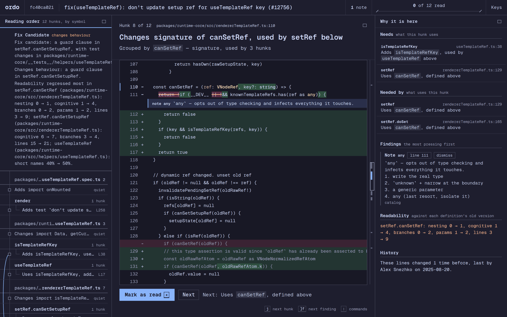

# ordo

<p>
  <a href="https://github.com/FoamScience/ordo/actions/workflows/ci.yml"></a>
  <a href="https://crates.io/crates/ordo-diff"></a>
  <!-- ordo:begin langs-badge -->
  
  <!-- ordo:end langs-badge -->
  <a href="LICENSE"></a>
</p>

Review a code change in reading order: definitions before their uses.

<picture>
  <source media="(prefers-color-scheme: dark)" srcset="assets/readme/reviewer-dark.png">
  <source media="(prefers-color-scheme: light)" srcset="assets/readme/reviewer-light.png">
  
</picture>

- **Reading order.** Each definition comes before the code that uses it, across
  files, parsed with tree-sitter ([languages](docs/languages.md)).
- **A reason per hunk.** One plain sentence: `adds parse_cfg, used in
  main.py`, `renames foo → bar`.
- **Skip the noise.** Imports, generated and lock files, and pure formatting
  are dimmed.
- **A verdict on the change.** Feature, likely fix or refactor; whether
  behaviour is preserved; which function got harder to read (nesting 2 → 3).
- **Findings on what changed.** Built-in construct checks and your own rules,
  flagged only where this change introduces them.
- **[Hunch](docs/hunch.md)** (opt-in). A trained guess of what a reviewer can
  skip and what needs care first.
- **Local and scriptable.** Runs on your machine; `ordo-engine` gives the same
  analysis as JSON or as compact text for an LLM.

## Install

```sh
curl -fsSL https://raw.githubusercontent.com/FoamScience/ordo/main/install.sh | sh
# or
cargo install ordo-diff --features web
```

Prebuilt binaries for Linux, macOS and Windows are on the
[releases page](https://github.com/FoamScience/ordo/releases).

## Use

```sh
ordo                       # review the last commit in a browser tab
ordo zz                    # uncommitted work
ordo main...feat           # a branch
git diff | ordo-engine review   # the same analysis as JSON, no git needed
```

`j` next hunk, `]f` next finding, `x` mark read, `:help` for commands.

## Docs

- [Reviewer](docs/web.md): revisions, keys, commands, themes
- [Hunch](docs/hunch.md): the opt-in trained guess
- [Engine and JSON schema](docs/cli.md)
- [What the rationales and findings mean](docs/reviewing.md)
- [Your own rules](docs/rules.md)
- [Supported languages](docs/languages.md)
- [What ordo does not do](docs/ceilings.md)
- [Architecture](docs/architecture.md)

Pre-1.0; see the [changelog](CHANGELOG.md) before upgrading.

## License

[MIT](LICENSE)
